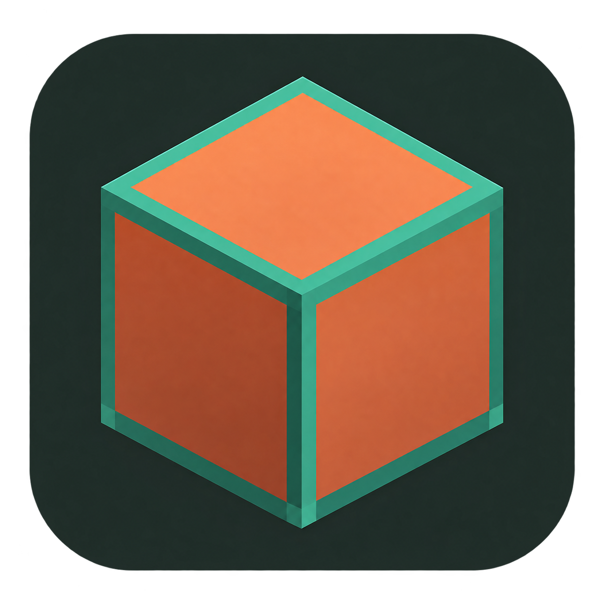

<p align="center"></p>

<h1 align="center">Copper Launcher</h1>
<p align="center">A Minecraft launcher focused on your instances, with a pixel-style interface.</p>
<p align="center"><a href="#download-and-install">Installer status</a> · <a href="#build-from-source">Build from source</a> · <a href="LICENSING.md">License</a></p>

**NOT AN OFFICIAL MINECRAFT PRODUCT. NOT APPROVED BY OR ASSOCIATED WITH MOJANG OR MICROSOFT.**

Copper is an independent fork of [Millida Launcher](https://github.com/millida/launcher), built with React, TypeScript, Rust and Tauri. It keeps the Minecraft-inspired look while simplifying the launcher around local instances and game launching.

## Features

- **Local instances** — create separate Minecraft setups, import modpacks and browse Modrinth.
- **Quick Start** — choose an instance and launch it from the main screen.
- **Accounts** — local profiles; Microsoft and Ely.by sign-in when the maintainer has configured their own registrations.
- **Skin library** — drop a 64×64 or 64×32 PNG into the skin window, preview it in 3D and save it locally. Pick saved skins using face thumbnails.
- **Startup screen** — a centered copper block on the dark Copper background, shared by the launcher, installer and uninstaller.
- **Copper installer** — a Windows installer and separate uninstaller with a matching interface.

The fork removes the original advertising, shop and subscription entry points, mandatory service login, launcher music, social notifications, chat, clips and cloud section. The original telemetry integration and automatic installation of its cosmetic mods have also been removed. See [the change notes](copper-launcher/COPPER-CHANGES.md) for details and remaining compatibility code.

## Download and install

**A reviewed replacement installer is not published yet.** Previous binaries are being withheld while the distribution cleanup is completed. The current source removes upstream artwork and OAuth-ID fallbacks. Microsoft/Ely.by sign-in requires the maintainer's own registrations; see [AUTH-SETUP.md](AUTH-SETUP.md). You can build the current source without these IDs to use local instance management.

Run the installer, choose a folder and install Copper for your Windows user. The installer includes the separate uninstaller. Uninstall the previous version before installing an update; game data is kept separately from the application.

Microsoft Edge WebView2 Runtime is required. The executable is currently unsigned.

**Development status:** this is an early fork. Full installation/uninstallation and game-launch testing are still in progress. Microsoft skin changes need further verification in-game. Removing the original telemetry integration does not amount to a security audit of every dependency.

## Build from source

### Requirements

- Windows with Visual Studio Build Tools: **MSVC x64/x86** and a **Windows SDK**.
- [Bun](https://bun.sh), [Node.js](https://nodejs.org) and [Rust](https://rustup.rs).

### Launcher

Clone the repository, then build the launcher:

```powershell
git clone https://github.com/CRIILET1221/CopperLauncher.git
cd CopperLauncher\copper-launcher
bun install
bun run tauri build
```

The launcher executable is generated in `copper-launcher/src-tauri/target/release/copper-launcher.exe`.

### Copper installer

After building the launcher, run this from the `copper-launcher` folder:

```powershell
powershell -NoProfile -ExecutionPolicy Bypass -File ..\copper-installer\build.ps1 -UseExistingLauncher
```

This builds the uninstaller and packages the compiled launcher into **Copper-Setup.exe** in the repository root. Omit `-UseExistingLauncher` to rebuild the launcher first. Keep the three source folders next to each other.

### Authentication configuration

Configure your own OAuth applications using `COPPER_MS_CLIENT_ID` and `COPPER_ELY_CLIENT_ID` before distributing your own builds. There are no upstream client-ID fallbacks. Until the maintainer configures their own registrations, Microsoft and Ely.by sign-in are unavailable. See [the setup guide](AUTH-SETUP.md) and [the configuration notes](copper-launcher/COPPER-CHANGES.md) and the preserved [upstream trademark/service notice](TRADEMARK.md).

## Repository layout

| Folder | Contents |
| --- | --- |
| [copper-launcher](copper-launcher) | Launcher UI and native backend |
| [copper-installer](copper-installer) | Custom Windows installer |
| [copper-uninstaller](copper-uninstaller) | Separate Windows uninstaller |

## License and credits

Copper is distributed under **GPL-3.0-only**, inherited from the original project. See [LICENSE](LICENSE) for the full terms, [LICENSING.md](LICENSING.md) for the project summary and [NOTICE](NOTICE) for attribution.

Original project: **Millida Launcher**. Copper fork maintained by **[CRIILET1221](https://github.com/CRIILET1221)**. Third-party notices and bundled font licenses are preserved.

Copper is not affiliated with or endorsed by Millida, Mojang or Microsoft. Minecraft names and assets remain subject to their respective owners' rights.
