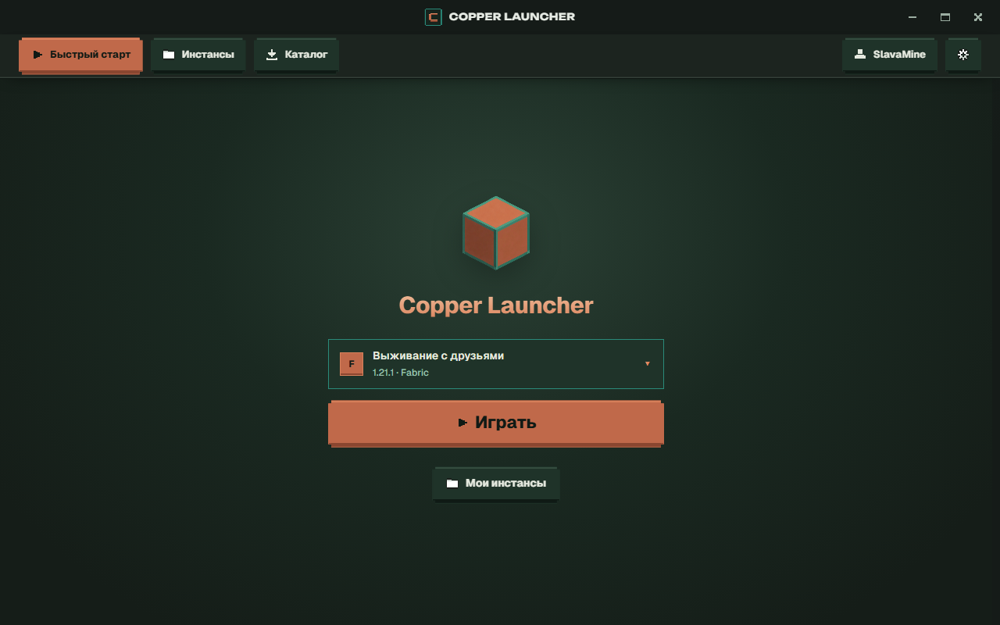
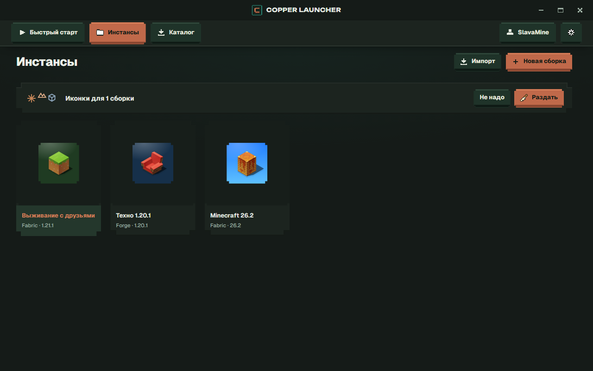
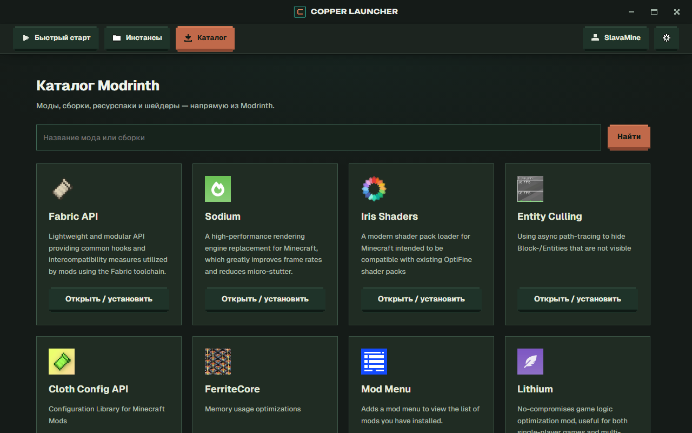

<p align="center">
  
</p>

<p align="center">
  <a href="https://github.com/CRIILET1221/CopperLauncher/releases/latest"></a>
  
  <a href="LICENSE"></a>
</p>

<p align="center">
  <a href="https://github.com/CRIILET1221/CopperLauncher/releases/latest"></a>
  <a href="https://github.com/CRIILET1221/CopperLauncher/releases"></a>
</p>

<p align="center">
  
</p>

## Возможности

<table>
  <tr>
    <td width="33%"><b>Сборки</b><br>Ванилла, Fabric, Forge, NeoForge и Quilt — у каждой своя папка с модами и мирами</td>
    <td width="33%"><b>Каталог</b><br>Modrinth и CurseForge с фильтрами по версии, загрузчику и категориям</td>
    <td width="33%"><b>Вход Microsoft</b><br>Официальная авторизация, пароль вводится только на сайте Microsoft</td>
  </tr>
  <tr>
    <td><b>Профиль и скины</b><br>Голова скина, смена аккаунтов, 3D-превью и своя коллекция скинов</td>
    <td><b>Автообновление</b><br>Лаунчер сам находит новую версию и ставит её в одну кнопку</td>
    <td><b>Без телеметрии</b><br>Ни статистики, ни рекламы, ни магазина — открытый код</td>
  </tr>
</table>

<p align="center">
  
  
</p>

## Установка

1. Скачай `Copper-Setup.exe` со страницы [последнего релиза](https://github.com/CRIILET1221/CopperLauncher/releases/latest).
2. Запусти установщик, выбери папку и нажми «Установить» — права администратора не нужны.
3. Открой лаунчер, войди через Microsoft и создай первую сборку. Java скачается сама.

> Если Windows покажет «Windows защитила ваш компьютер», нажми **«Подробнее» → «Выполнить в любом случае»**: у установщика пока нет платной цифровой подписи.

| Система | Игра | Компоненты |
| --- | --- | --- |
| Windows 10 или 11, 64-бит | Лицензия Minecraft: Java Edition | WebView2 (в Windows 11 уже есть) |

## Сборка из исходников

Нужны Bun, Node.js, Rust и Visual Studio Build Tools с компонентом C++. Подробно — в [BUILDING.md](copper-launcher/BUILDING.md).

```powershell
git clone https://github.com/CRIILET1221/CopperLauncher.git
cd CopperLauncher\copper-launcher
bun install
bun run build:setup
```

| Команда | Что делает |
| --- | --- |
| `bun run tauri dev` | запуск из исходников без установки |
| `bun run build:setup` | установщик `outputs\Copper-Setup.exe` |
| `bun run set-version 2.0.5` | поднять версию перед релизом |

## Лицензия

Copper распространяется по лицензии [GPL-3.0](LICENSE). Часть кода основана на другом лаунчере под GPL — исходные уведомления об авторских правах сохранены в [NOTICE](NOTICE).

<sub>Не является официальным продуктом Minecraft. Не одобрен Mojang или Microsoft и не связан с ними.</sub>
